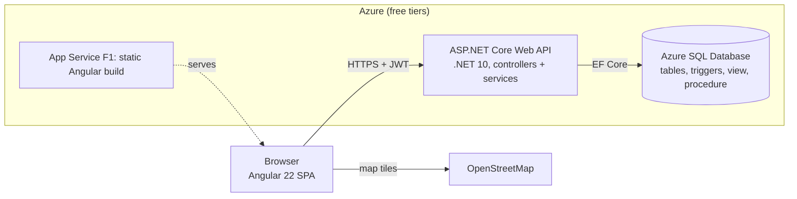

# Thornton Energy: Electric Management App (v2.0)

A customer portal and operations back office for **Thornton Energy Inc.**, a fictional electric utility serving central New Jersey. Customers view and pay bills, track usage, compare rate plans and report outages. Admins manage accounts, meters, rate plans, billing and the outage queue, and get a live KPI dashboard, an audit trail and an outage map.

Built as a client demo. v1 was an Angular app on a mock REST API. **v2 is a real three-tier application running on Azure.**

## Live demo

| | URL |
|---|---|
| Web app | https://thornton-energy-web-drg8hqcqeudndtf9.centralus-01.azurewebsites.net |
| API (base) | https://thornton-energy-api-f2hcgjatdwfzdje5.centralus-01.azurewebsites.net/api |

The database is on Azure SQL's free tier, which **pauses itself when idle**. The first request after a quiet period can take 30 seconds or more while it wakes up.

### Demo logins

| Role | Email | Password | Good for showing |
|---|---|---|---|
| Admin | `support@thornenergy.com` | `admin123` | Every admin page |
| Customer | `jane@example.com` | `jane123` | Unpaid bill, active outage, usage history |
| Customer | `john@example.com` | `john123` | Time-of-Use plan |
| Customer | `maria@example.com` | `maria123` | Fully paid account, Green Energy plan |

These are demo accounts with demo data only.

## Architecture



Inside the API, a request flows through layers, each with one job:

`middleware -> authentication -> authorization -> controller -> service -> repository -> DbContext -> SQL`

See [docs/ARCHITECTURE.md](docs/ARCHITECTURE.md) for a file-by-file map and the data model.

## Tech stack

| Layer | Technology |
|---|---|
| Front end | Angular 22 (standalone components, signals, reactive forms, `HttpClient` + interceptor), Leaflet maps, Vitest |
| API | ASP.NET Core Web API on .NET 10, controllers, services, generic repository, DTOs, AutoMapper |
| Data | Entity Framework Core 10 (code first, migrations), Azure SQL Database, SQL triggers, view and stored procedure |
| Security | JWT bearer tokens (HS256), BCrypt password hashes, role and ownership checks, rate limiting, CORS allow-list |
| Tests | xUnit, Moq, `WebApplicationFactory` with SQLite for integration tests, coverlet |
| Hosting | Azure App Service (Windows, Free F1) for the API and the static front end |

## Features

**Customer portal (`/account`)**

- Dashboard: balance due, this month's usage, active outage banner, map of the service location
- Usage history chart from meter readings
- Billing history with bill detail and **Pay Now**
- Report an outage and follow its status
- Rate plan comparison with an estimate for this customer's real usage, and one-click plan switch

**Admin portal (`/admin`)**

- Dashboard with six KPI cards and a monthly usage and billing bar chart (calculated in the database)
- Customers: search, filter, change account status
- Billing: monthly totals and a billing run (prices come from the customer's rate plan)
- Meters and readings (readings must be later and not lower than the previous one)
- Rate plans: create, edit, delete (blocked while customers are on the plan)
- Outage queue and **outage map** (red = reported, amber = in progress, green = resolved)
- **Activity**: an audit trail of status and rate-plan changes, written by SQL triggers (what changed, old to new, who)
- Inbox for contact-form messages

## Security model

- **Authentication:** `POST /api/auth/login` checks a BCrypt password hash and returns a signed JWT (HS256, 60 minutes) with the claims `sub`, `email`, `role` and `customerId`. The API validates signature, issuer, audience and expiry on every request. Suspended or closed accounts cannot sign in, and the server enforces that.
- **Secure by default:** every endpoint requires a signed-in user unless it says `[AllowAnonymous]`. The only public endpoints are login, register, `GET /api/ratePlans` and `POST /api/messages` (the contact form).
- **Roles:** admin-only endpoints use `[Authorize(Roles = "Admin")]`, so a customer gets **403**.
- **Ownership:** customers can only read or change their own bills, meters, readings and outages. The rule lives in one place (`CurrentUser`) and is used by the services, so a customer asking for someone else's data gets **403** even if they guess the id.
- **Server-side rules:** the browser is never trusted for money or time. Bills are priced from the rate plan, payment dates and outage timestamps are set by the server, and "overdue" is calculated rather than stored.
- **Rate limiting:** login, register and the contact form allow 10 requests per minute per IP (then 429).
- **Validation:** request DTOs use Data Annotations; bad input returns 400.
- **Errors:** unhandled exceptions become a clean JSON problem response with a correlation id (`X-Correlation-ID`); stack traces appear only in Development.
- **Secrets:** never in git. Locally they live in .NET user secrets; in Azure they are App Service settings (`Jwt__Key`, the connection string).
- **Why JWT in a header and not a cookie:** the front end and the API are different sites (two subdomains of `azurewebsites.net`, which is on the public suffix list), so cookies would be third-party cookies that browsers increasingly block. A bearer token sent by the Angular interceptor works across both sites and is not exposed to cross-site request forgery. The trade-off is that the token is kept in `sessionStorage` (cleared when the tab closes), so we rely on Angular's output escaping and the short token lifetime.

## Run it locally

**Prerequisites:** .NET 10 SDK, Node.js and npm, access to a SQL Server (Azure SQL or LocalDB), `dotnet-ef`.

1. **Secrets** (once), from `server/ThorntonEnergy.Api`:
   ```powershell
   dotnet user-secrets set "ConnectionStrings:DefaultConnection" "<your SQL Server connection string>"
   dotnet user-secrets set "Jwt:Key" "<a random string of 32 or more characters>"
   ```
2. **Database:** `dotnet ef database update` creates the tables, triggers, view and procedure. The first start of the API fills an empty database with demo data.
3. **API:** `dotnet run --launch-profile https` serves https://localhost:7159 (Swagger UI at `/swagger` in Development).
4. **Front end:** from `client`, `npm install` then `npm start` serves http://localhost:4200 (it calls the local API).

## Testing

```powershell
# Server: unit tests + integration tests (in-memory SQLite), with coverage
cd server
dotnet test --collect:"XPlat Code Coverage"

# Front end: unit tests, with coverage
cd client
npx ng test --watch=false --coverage
```

- **Unit tests** cover the billing rules, token creation, ownership rules, and the bill and meter services (pay once, ownership, overdue, reading order).
- **Integration tests** start the whole API in memory and check the security rules over HTTP: 401 without a token, 403 for a customer on an admin endpoint or another customer's bill, wrong password, successful login, and full workflows.
- The admin KPI view, the usage procedure and the audit session interceptor only exist in SQL Server, so SQLite tests cover only who may call those endpoints.

## Deployment

Both apps run in the resource group `rg-thornton-energy` (Central US) on one free App Service plan. Add any new app setting in Azure **before** deploying code that needs it (the API refuses to start without `Jwt__Key`).

```powershell
# API (from server\ThorntonEnergy.Api)
dotnet publish -c Release -o "$env:TEMP\thornton-api"
Compress-Archive -Path "$env:TEMP\thornton-api\*" -DestinationPath "$env:TEMP\thornton-api.zip" -Force
az webapp deploy --resource-group rg-thornton-energy --name thornton-energy-api --src-path "$env:TEMP\thornton-api.zip" --type zip

# Front end (from client)
npx ng build
Compress-Archive -Path "dist\Electric-Management-App\browser\*" -DestinationPath "$env:TEMP\thornton-web.zip" -Force
az webapp deploy --resource-group rg-thornton-energy --name thornton-energy-web --src-path "$env:TEMP\thornton-web.zip" --type zip
```

Apply new database migrations with `dotnet ef database update` (uses the connection string in user secrets) before deploying code that depends on them.

## Skills and technologies demonstrated

- Layered web API design: controllers for HTTP only, services for business rules, a generic repository for data access, DTOs and AutoMapper at the boundary, a `Result<T>` type instead of exceptions for expected failures
- Dependency injection (scoped, singleton, open generics), the options pattern, custom middleware, structured logging with correlation ids
- Authentication and authorization with JWT, roles and per-record ownership, BCrypt hashing, rate limiting, CORS, secrets management
- Relational design with EF Core code-first migrations, optimistic concurrency (`rowversion`), enums as text, unique indexes
- SQL Server: audit triggers, a view, a stored procedure, `SESSION_CONTEXT`, time-zone conversion, all delivered through migrations
- Testing: xUnit theories, Moq, in-memory SQLite, `WebApplicationFactory` integration tests, code coverage
- Angular: standalone components, signals, reactive forms, an HTTP interceptor, route guards, lazy loading, Leaflet maps, plain CSS charts
- Cloud: Azure App Service, Azure SQL, CLI deployments, configuration through app settings

## How AI was used

An AI coding assistant helped write code, SQL and documents. Every AI-assisted SQL object and document is logged in [docs/AI-LOG.md](docs/AI-LOG.md) with the prompt, what came back, and what was checked or changed.

## More documentation

- [docs/ARCHITECTURE.md](docs/ARCHITECTURE.md): file-by-file map, request flow, data model
- [docs/BRD.md](docs/BRD.md): business requirements
- [docs/DEMO.md](docs/DEMO.md): five-minute demo script
- [docs/AI-LOG.md](docs/AI-LOG.md): AI usage log
