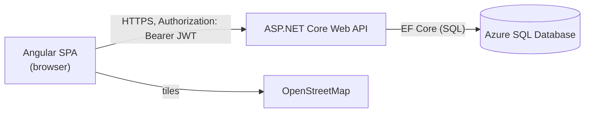
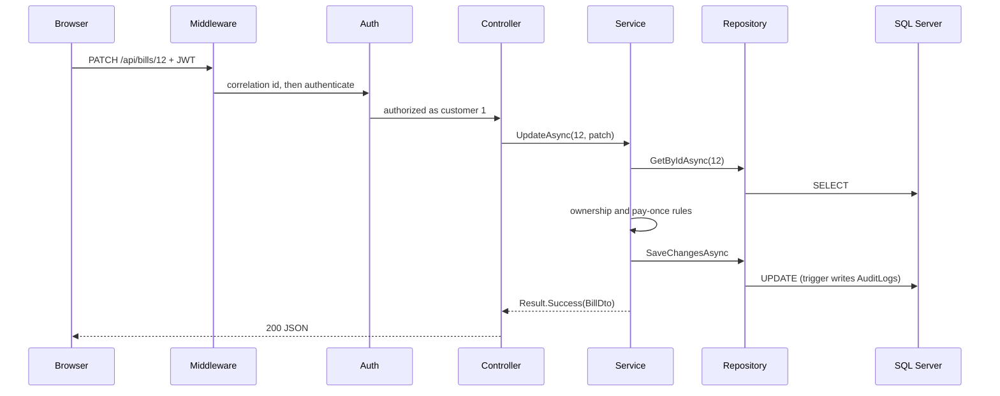
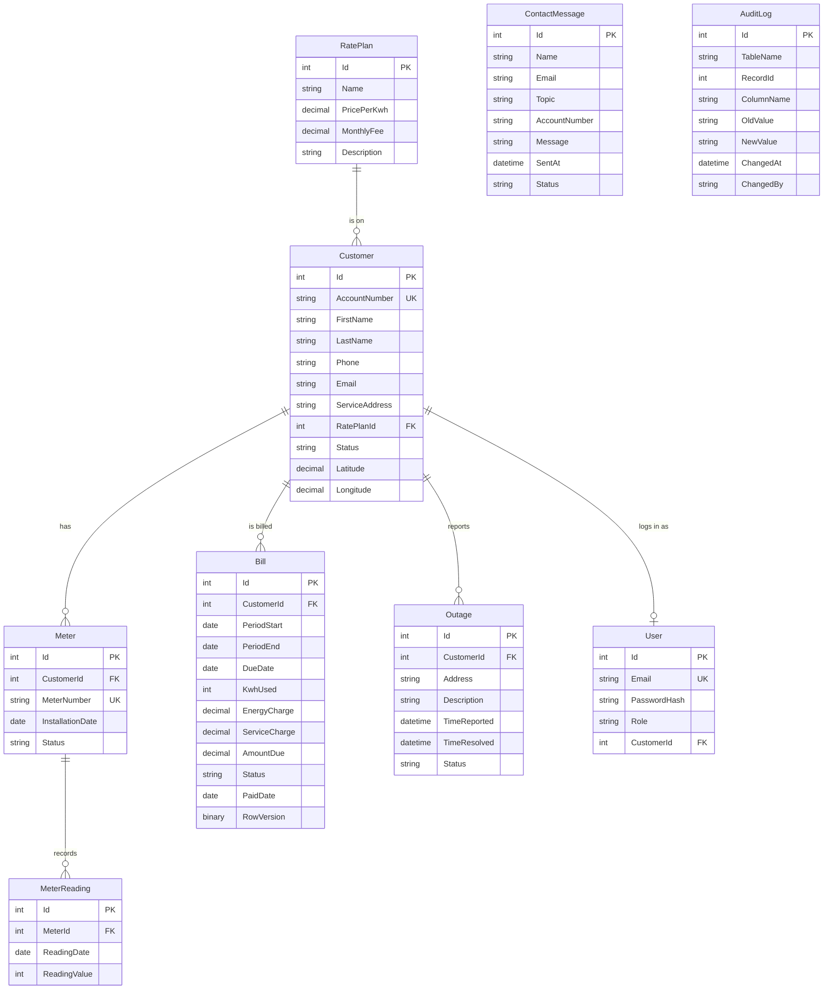

# Architecture and file map

This is the study guide for the codebase: how a request travels through the system, what every folder and important file is for, and how the data fits together.

## 1. The big picture



- **Front end** (`client/`): Angular 22 single-page app, served as static files by an Azure App Service.
- **API** (`server/ThorntonEnergy.Api/`): ASP.NET Core Web API on .NET 10 with controllers, hosted on a second App Service.
- **Database**: Azure SQL Database (free offer, it pauses when idle). EF Core code-first migrations create everything, including triggers, a view and a stored procedure.

## 2. Request flow

Following one request, "customer Jane pays a bill" (`PATCH /api/bills/12` with `{ "status": "paid" }`):

1. **Browser (component):** `BillDetail` calls `BillService.payBill(12)` (`client/src/app/services/bill-service.ts`).
2. **Interceptor:** `authInterceptor` adds `Authorization: Bearer <token>` (only for requests to our API). If the API ever answers 401 it logs the user out and goes to `/login`.
3. **Middleware:** `RequestLoggingMiddleware` gives the request a correlation id and times it; `ExceptionHandlingMiddleware` waits to turn any unexpected error into a clean JSON response.
4. **CORS:** only the allowed front-end origins may call the API from a browser.
5. **Authentication:** the JWT bearer handler checks signature, issuer, audience and expiry, then builds the user (claims: `sub`, `email`, `role`, `customerId`).
6. **Authorization:** the fallback policy refuses anonymous callers (401); `[Authorize(Roles = ...)]` refuses the wrong role (403).
7. **Rate limiter:** applies only to endpoints marked `[EnableRateLimiting]` (login, register, contact form).
8. **Controller:** `BillsController.Update` does no thinking. It calls `IBillService.UpdateAsync` and turns the returned `Result<BillDto>` into an HTTP response.
9. **Service:** `BillService` applies the rules: is this the caller's own bill (`ICurrentUser`), is it already paid (409), set `PaidDate` to the server's "today" (`IUtilityClock`), log the change.
10. **Repository:** `IRepository<Bill>` (`EfRepository<Bill>`) loads and saves the entity.
11. **DbContext:** EF Core translates the change to SQL. `AppUserSessionInterceptor` first tells SQL Server who is signed in.
12. **SQL Server:** the `UPDATE` fires the `trg_Bills_Audit` trigger, which writes an `AuditLogs` row (old value, new value, time, user).
13. **Back out:** the service maps the entity to a `BillDto` (AutoMapper), the controller returns 200 JSON, the browser updates its signals.



## 3. Repository layout

```
Electric-Management-App/
├── README.md                    Project overview, live links, setup, security model
├── CLAUDE.md                    Working notes for the AI assistant (not part of the app)
├── .gitignore
├── docs/                        Documentation (this folder)
├── client/                      Angular front end
└── server/                      .NET back end and its tests
```

### 3.1 `docs/`

| File | Purpose |
|---|---|
| `ARCHITECTURE.md` | This document |
| `BRD.md` | Business requirements document |
| `DEMO.md` | Five-minute demo script |
| `AI-LOG.md` | Where AI helped write SQL and documents, what was checked or changed |

### 3.2 `server/`

| Path | Purpose |
|---|---|
| `ThorntonEnergy.slnx` | Solution file: the API project and the test project |
| `ThorntonEnergy.Api/` | The Web API (below) |
| `ThorntonEnergy.Api.Tests/` | Automated tests (section 3.3) |

#### `server/ThorntonEnergy.Api/` (the API)

| File or folder | Responsibility |
|---|---|
| `Program.cs` | Starts the app: registers services (dependency injection), authentication, authorization, rate limiting, CORS, JSON options, OpenAPI; sets the middleware order; seeds an empty database (not in the Testing environment). Ends with `public partial class Program` so tests can start the app. |
| `appsettings.json` | Non-secret settings: logging, CORS origins, JWT issuer, audience and lifetime, time zone (`App:TimeZone`) |
| `appsettings.Development.json` | Settings that only apply on a developer machine |
| `Properties/launchSettings.json` | `dotnet run` profiles (the `https` profile serves https://localhost:7159) |
| `ThorntonEnergy.Api.http` | Sample requests for the editor |
| `ThorntonEnergy.Api.csproj` | Packages (EF Core, JWT bearer, BCrypt, AutoMapper, OpenAPI, Swagger UI) and the user-secrets id |

**`Controllers/`: HTTP only.** Each action calls a service and converts its `Result<T>` to a status code.

| File | Endpoints |
|---|---|
| `AppControllerBase.cs` | `FromResult` and `Failure`: success becomes 200 with the value; NotFound, Unauthorized, Forbidden, Invalid and Conflict become 404, 401, 403, 400 and 409 |
| `AuthController.cs` | `POST auth/login`, `POST auth/register` (public, rate limited), `GET auth/me` |
| `BillsController.cs` | `GET bills`, `GET bills/{id}`, `POST bills` (admin), `PATCH bills/{id}` |
| `CustomersController.cs` | `GET customers` (admin), `GET customers/{id}`, `PATCH customers/{id}` |
| `MetersController.cs` | `GET meters`, `PATCH meters/{id}` (admin) |
| `MeterReadingsController.cs` | `GET meterReadings`, `GET meterReadings/{id}`, `POST meterReadings` (admin) |
| `OutagesController.cs` | `GET outages`, `GET outages/map` (admin), `GET outages/{id}`, `POST outages`, `PATCH outages/{id}` (admin) |
| `RatePlansController.cs` | `GET ratePlans` (public), `GET {id}`, `POST`, `PUT {id}`, `DELETE {id}` (admin) |
| `MessagesController.cs` | `POST messages` (public, rate limited), `GET messages`, `GET messages/{id}`, `PATCH messages/{id}` (admin) |
| `AdminController.cs` | `GET admin/kpis`, `GET admin/usage-trend?months=`, `GET admin/activity?take=` (admin) |

**`Services/`: business rules.** Each service is an interface plus a class.

| File | Responsibility |
|---|---|
| `AuthService.cs` | Login (BCrypt check, account status, logs failed attempts without passwords) and register |
| `BillService.cs` | List and read with ownership; create bills priced from the rate plan; duplicate-period check; pay once with the server's date |
| `CustomerService.cs` | Read with ownership; change rate plan (customer) or status (admin only) |
| `MeterService.cs` | Meters and readings; a new reading must be later and not lower than the previous one |
| `OutageService.cs` | Customers report for themselves; the server stamps report and resolve times; the map query |
| `MessageService.cs` | Contact messages: server sets the time and the "new" status |
| `RatePlanService.cs` | Rate plan CRUD; delete is blocked while customers are on the plan |
| `AdminInsightService.cs` | Reads the KPI view, calls the usage stored procedure, lists the audit log |
| `BillingRules.cs` | Pure functions: price a bill, due date (+21 days), effective (overdue) status |
| `ITokenService.cs`, `TokenService.cs` | Creates the signed JWT with the user's claims |

**`Data/`: database access.**

| File | Responsibility |
|---|---|
| `AppDbContext.cs` | EF Core model: tables, money precision, enums stored as text, unique indexes, delete rules, trigger declarations, the KPI view mapping |
| `IRepository.cs`, `EfRepository.cs` | Generic repository (`Query`, `GetByIdAsync`, `Add`, `Remove`, `SaveChangesAsync`), registered as an open generic |
| `AppUserSessionInterceptor.cs` | On every connection open, sets SQL `SESSION_CONTEXT('AppUser')` to the signed-in email so audit triggers can record who changed what |
| `DbSeeder.cs`, `seed.json` | Fills an empty database with demo data (keeps the original ids with `IDENTITY_INSERT`) |

**`Models/`: the tables (entities).** `Bill`, `Customer`, `Meter`, `MeterReading`, `Outage`, `RatePlan`, `ContactMessage`, `User`, `AuditLog`, `Enums.cs` (status enums), and `AdminKpis.cs` (the shape of the KPI view row and the usage procedure row; not tables).

**`Dtos/`: what goes in and out of the API.**

| File | Purpose |
|---|---|
| `ResponseDtos.cs` | What the API sends back (`BillDto`, `CustomerDto`, `OutageDto`, ..., `AdminKpisDto`, `OutageMapDto`). Entities never leave the server directly. |
| `RequestDtos.cs` | What the API accepts when creating things, with validation attributes. Totals, timestamps and statuses are deliberately missing: the server decides them. |
| `ApiDtos.cs` | Login and register requests (validated), the auth response, and the small PATCH bodies |

**Other folders.**

| File or folder | Responsibility |
|---|---|
| `Auth/AuthConstants.cs` | Claim names, role names, the rate-limit policy name |
| `Auth/ClaimsPrincipalExtensions.cs` | Helpers to read id, email, role and customer id from the token |
| `Auth/CurrentUser.cs` | `ICurrentUser`: who is calling, and the ownership rules (`CanAccessCustomer`, `TryGetCustomerScope`) |
| `Auth/JwtOptions.cs` | Typed JWT settings |
| `Common/Result.cs` | `Result<T>` with `Success`, `NotFound`, `Unauthorized`, `Forbidden`, `Invalid`, `Conflict` |
| `Common/UtilityClock.cs` | `IUtilityClock`: "now" and "today" in Eastern time, built on `TimeProvider` |
| `Mapping/MappingProfile.cs` | AutoMapper: entity to DTO and request to entity |
| `Middleware/RequestLoggingMiddleware.cs` | Correlation id (`X-Correlation-ID`), request log line with timing |
| `Middleware/ExceptionHandlingMiddleware.cs` | Unhandled errors become `application/problem+json`; concurrency conflicts become 409 |
| `OpenApi/BearerSecuritySchemeTransformer.cs` | Adds the Authorize button to Swagger UI |
| `Migrations/` | Generated EF migrations (see below) |

**Migrations**

| Migration | What it does |
|---|---|
| `InitialCreate` | All tables, indexes and foreign keys |
| `AddBillRowVersion` | `rowversion` column on `Bills` for optimistic concurrency |
| `AdminInsight` | `AuditLogs` table, three audit triggers, `vw_AdminKpis` view, `usp_GetMonthlyUsage` procedure |
| `AddCustomerCoordinates` | `Latitude` and `Longitude` on `Customers`, plus a data update for the demo customers |

### 3.3 `server/ThorntonEnergy.Api.Tests/`

| File | Purpose |
|---|---|
| `Helpers/TestDb.cs` | In-memory SQLite database with a tiny dataset (2 customers, 3 logins, bills, a meter) |
| `Unit/BillingRulesTests.cs` | Pricing, rounding, due date, overdue rules |
| `Unit/TokenServiceTests.cs` | Token claims, expiry (fake clock), signature |
| `Unit/CurrentUserTests.cs` | Ownership rules |
| `Unit/BillServiceTests.cs` | Pay once, ownership, overdue, server pricing, duplicates |
| `Unit/MeterServiceTests.cs` | Reading order and value rules |
| `Integration/ApiFactory.cs` | Starts the real API in memory with SQLite |
| `Integration/ApiTests.cs` | 401 and 403 rules, login, ownership, validation |
| `Integration/ApiWorkflowTests.cs` | Whole workflows: bills, readings, outages, rate plans, messages, register |
| `coverlet.runsettings` | Coverage settings (leaves out generated migrations and the seeder) |

### 3.4 `client/`

| File or folder | Responsibility |
|---|---|
| `package.json`, `angular.json` | Dependencies and build settings (Leaflet's stylesheet is added here) |
| `tsconfig*.json`, `.prettierrc`, `.editorconfig` | TypeScript and formatting settings |
| `public/web.config` | Tells IIS on Azure to serve `index.html` for any route, so deep links like `/admin/activity` work |
| `public/images/` | Photos used on the landing and about pages |
| `src/index.html`, `src/main.ts` | Entry point: bootstraps the `App` component |
| `src/styles.css` | Global styles and design tokens (colors, cards, tables, badges) |
| `src/environments/` | `environment.ts` (live API URL, used by production builds) and `environment.development.ts` (https://localhost:7159/api for `npm start`) |

**`src/app/` (application code)**

| File or folder | Responsibility |
|---|---|
| `app.ts`, `app.html`, `app.css` | The shell: navbar, router outlet, footer |
| `app.config.ts` | Providers: router and `HttpClient` with the auth interceptor |
| `app.routes.ts` | All routes, lazy-loaded; `/account/**` needs the customer role, `/admin/**` the admin role |
| `guards/auth-guard.ts` | One guard for both portals: checks login and role (`data: { role }`) and redirects |
| `interceptors/auth-interceptor.ts` | Adds the Bearer token to API calls; on 401 logs out and redirects to login |
| `services/` | One service per API area (`auth`, `bill`, `customer`, `meter`, `outage`, `rate-plan`, `message`, `admin-insight`). Components never call `HttpClient` directly. |
| `interfaces/` | TypeScript shapes of the API's JSON |
| `utils/api.ts` | `API_URL` from the environment file |
| `utils/billing.ts`, `usage.ts`, `dates.ts`, `validators.ts` | Bill building and overdue helper, monthly usage from readings, date strings in local time, password-match validator |
| `pipes/status-label-pipe.ts` | `in_progress` to "In Progress" |
| `directives/status-badge.ts` | Colored status badge |
| `components/` (public) | `landing`, `about`, `contact`, `login`, `register`, `navbar`, `footer`, `not-found` |
| `components/account/` | Customer portal: `account-layout`, `account-dashboard`, `usage-history`, `billing-history`, `bill-detail`, `customer-outages`, `rate-plan-compare` |
| `components/admin/` | Admin portal: `admin-layout`, `admin-dashboard` (KPIs and chart), `admin-customers`, `admin-billing`, `admin-meters`, `admin-rate-plans`, `admin-outages`, `admin-outage-map`, `admin-activity`, `admin-messages` |
| `components/map-view/` | Reusable Leaflet map (OpenStreetMap tiles, colored dots) used by the admin map and the customer dashboard |
| `*.spec.ts` | Vitest tests, next to the code they test (services' specs are in `services/tests/`) |

## 4. Data model



Notes on the model:

- `Customer.RatePlanId` uses **restrict** on delete: a plan cannot be deleted while customers are on it.
- `User.CustomerId` is null for admins. `Email`, `AccountNumber` and `MeterNumber` are unique.
- Enums (status, role, topic) are stored as readable text (`Unpaid`, `InProgress`); the JSON uses snake_case (`in_progress`).
- `Bill.Status` stores only `Unpaid` or `Paid`. **Overdue is never stored**: it is calculated from the due date every time bills are read (and in the KPI view).
- `ContactMessage` and `AuditLog` are not linked by foreign keys (a message may come from someone with no account; the audit log must survive deletes).
- **Triggers** `trg_Bills_Audit`, `trg_Customers_Audit`, `trg_Outages_Audit` write to `AuditLogs` when a status (or a customer's rate plan) changes. EF is told about them with `HasTrigger`.
- **View** `vw_AdminKpis` (one row of company-wide numbers) and **procedure** `usp_GetMonthlyUsage @Months` (kWh and billed total per month) feed the admin dashboard.
- Times are stored as Eastern wall-clock time (the utility's time zone), not UTC.
